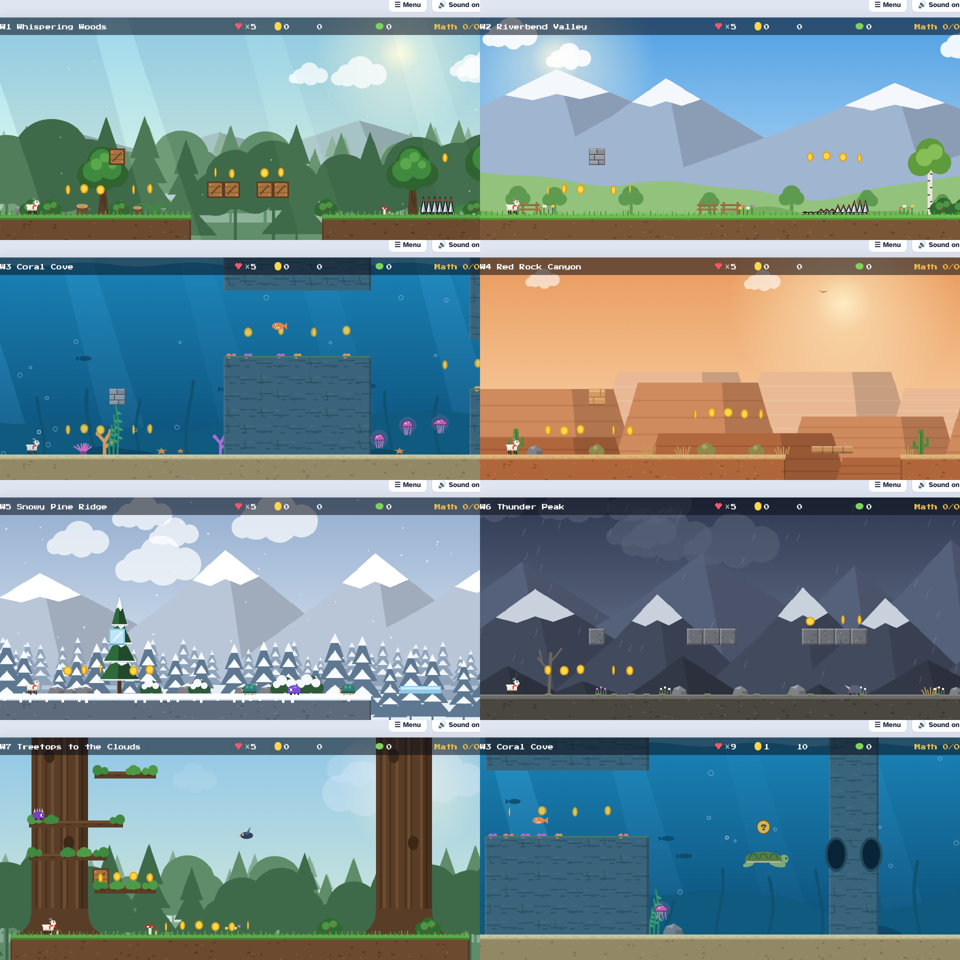
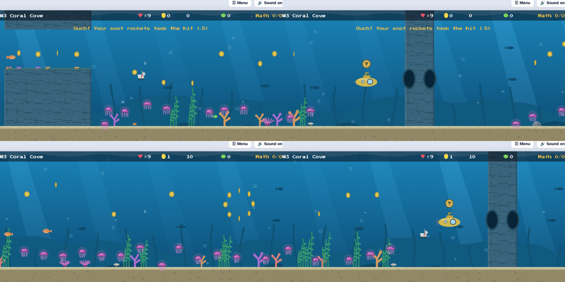

# Bramble’s Summit: 4th Grade Math Climb

A browser platformer where students guide Bramble the goat from the forest floor up to a castle in the clouds to rescue Professor Goat, by solving 4th grade enrichment math problems.

## Play

Open `index.html` in any modern browser. Nothing to install or build.

To share with students, turn on **GitHub Pages** (Settings → Pages → Deploy from branch `main`, folder `/root`), then share the link it gives you.

## What’s inside

- **Seven worlds:** Whispering Woods, Riverbend Valley, Coral Cove (underwater), Red Rock Canyon, Snowy Pine Ridge, Thunder Peak, and Treetops to the Clouds.
- **Coral Cove:** an underwater world. Tap jump to swim. Stinging jellyfish cover most of the sea floor and can’t be stomped or sneezed away. Swim through gaps in coral columns and along narrow rock tunnels.
- **Checkpoint rides:** two per world (hollow oak tunnel, zip line, raft, hot air balloon, submarine, giant sea turtle, mine cart, barrel cannon, cable car, basket lift). Students board a ride by answering a math question correctly.
- **Castles:** every castle has its own look and gets harder as you climb. They start with just lava pits and flame jets, then add cannons firing big cannonballs (jump over them or bounce on top), bridges that crumble under your feet, swinging axes and crushing stone blocks. The final castle uses all of them. After the hall comes a boss fight.
- **Final world:** climb a giant tree, then cross drifting, elevator and vanishing clouds.
- **Bricks:** jump into a brick from below to smash it and knock out any enemy standing on it.
- **Spikes:** they match each world (thorny brambles, red rock shards, ice spikes, quartz crystals) with dark outlines so they’re easy to see. Some pop up and down out of holes in the ground, so you have to time your crossing.
- **Bonus round:** 90 seconds of questions after each world earns slot machine spins.

## Math

Questions are generated fresh each time (41 question types) at three levels: Warm-up, Challenge and Brain-buster. Topics include place value, rounding, addition and subtraction, multi-digit multiplication, multiplying by 10s/100s/1000s, long division with and without remainders, factors and multiples, prime and composite numbers, powers of single-digit numbers, fractions and decimals, measurement, elapsed time, money, angles, area and perimeter, patterns, and multi-step word problems. Each answer comes with a step-by-step explanation.

Questions a device has already seen are remembered in the browser so they don’t repeat.

